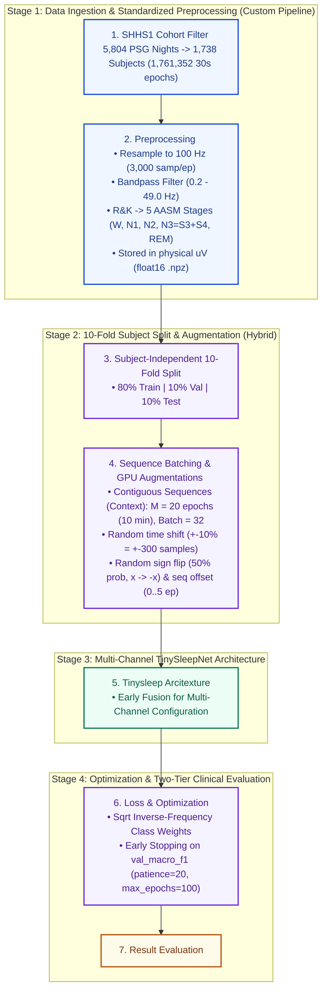
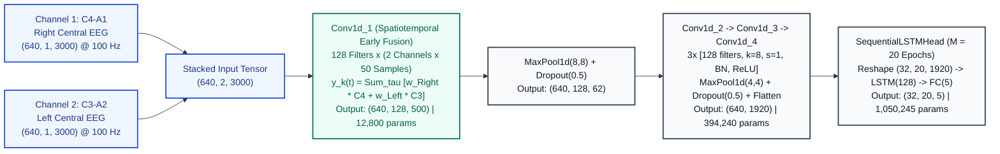
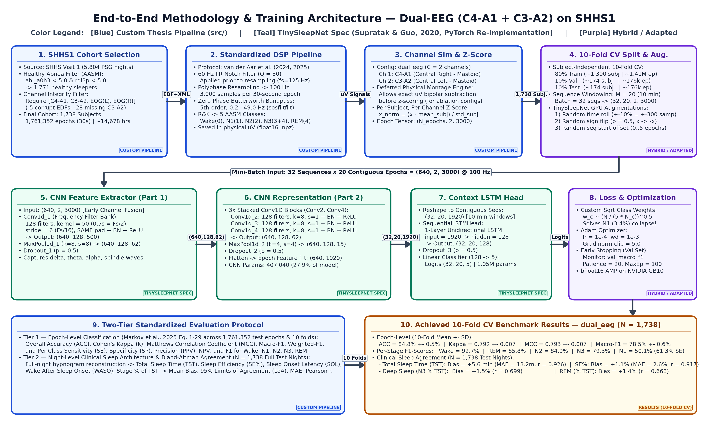

# End-to-End Methodology & Architecture Diagrams (`dual_eeg` on SHHS1)

This file contains the Mermaid source code (rendered natively on GitHub and VS Code) and links to the high-resolution PNG diagram for the **10-fold subject-independent CV training of `dual_eeg` (`C4-A1` + `C3-A2`)** on **1,738 healthy SHHS1 subjects** (`1,761,352` 30-second epochs).

---

## 1. End-to-End Pipeline & Training Architecture (Mermaid Flowchart)

- **Blue (`Custom Pipeline`)**: Custom-engineered modules written from scratch for this thesis (`src/data/preprocessing.py`, `src/data/channel_sim.py`, `src/evaluation/metrics.py`, `src/evaluation/clinical_sleep.py`).
- **Green (`TinySleepNet Spec`)**: Exact neural network architecture & signal augmentations from Supratak & Guo (EMBC 2020), custom re-implemented in modular PyTorch (`src/models/tinysleepnet.py`).
- **Purple (`Hybrid / Adapted`)**: TinySleepNet training protocol extended with subject-independent 10-fold CV, square-root inverse-frequency class weights (`w_c`), and `bfloat16` mixed precision (`src/data/dataset.py`, `src/training/trainer.py`).

---

## 2. Multi-Channel Early Fusion (`Conv1d_1`) vs. Separate CNN Branches (Mermaid Diagram)

---

## 3. High-Resolution PNG Diagram

